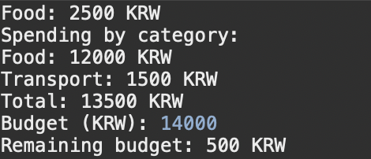
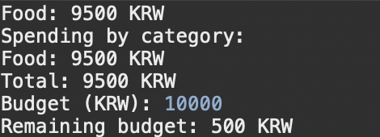
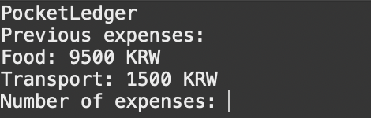
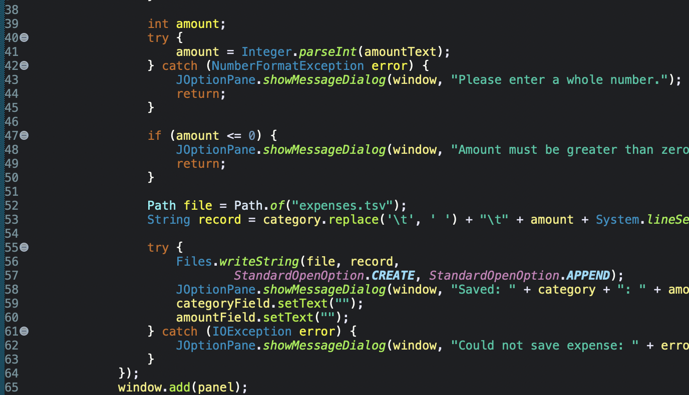

# PocketLedgerCourse

PocketLedgerCourse is a Java Swing application for recording and analyzing personal expenses.

## Motivation

I chose this topic because small everyday expenses, such as meals, bus fares, and books, can be hard to track. The application lets users record those expenses, see how much they spent in each category, and compare their total spending with a budget.

## Features and Design

- Enter an expense category and a positive amount in Korean won.
- Save each expense to `expenses.tsv` and display previous records when the application opens.
- Group expenses by category and calculate total spending.
- Enter a budget to see the remaining amount or how much spending went over budget.

The project has three Java files:

| File | Purpose |
| --- | --- |
| `ExpenseWindow.java` | Builds the Swing window and handles expense entry, history, spending analysis, and budget checks. |
| `ExpenseHistory.java` | Reads and saves expenses and calculates category totals. |
| `ExpenseTracker.java` | Provides a console version for recording expenses and checking the results. |

## How to Run

1. Download or clone this repository.
2. In Eclipse, select **File → Import → General → Existing Projects into Workspace** and select the project folder.
3. Open `ExpenseWindow.java` under `src/pocketledger`.
4. Right-click in the editor and select **Run As → Java Application**.
5. Enter a category and an amount, then click **Add**. Use **History** to view saved expenses and **Spending Analysis** to see the totals. Enter an amount in **Budget (KRW)** and click **Check Budget** to compare it with your saved spending.

## Test Results

During development, I entered two Food expenses of 9,500 KRW and 2,500 KRW and one Transport expense of 1,500 KRW. The console version showed 12,000 KRW for Food and 13,500 KRW in total. With a budget of 14,000 KRW, it showed 500 KRW remaining.

I also checked that an expense saved from the Swing window appeared in the console version after restarting. Additional checks with a temporary ledger verified that the window rejects invalid amounts and refreshes the history and totals after saving.

## Discussion

A table of categories and amounts is enough for this version, so I used a local tab-separated text file. It is easy to open and inspect. The window compares the budget with all saved expenses. Adding dates would make it possible to compare spending month by month.

## References and Contributions

- Java Programming (02) course materials on Java, Swing, and file input/output.
- Java SE documentation for Swing, `Files`, and `LinkedHashMap`.

I chose the topic of personal expense tracking. I built and tested the initial console and Swing versions in Eclipse with step-by-step guidance. I also referred to tutorials on Xiaohongshu for parts of the implementation.

## Development Screenshots

These Eclipse screenshots were captured on November 27, 2026 (Korean Standard Time) during development and added to GitHub after the initial project import. The images are cropped to omit local file paths.

| Time | Development step |
| --- | --- |
| 18:59:21 | The console grouped expenses by category and showed 500 KRW remaining from a 14,000 KRW budget. |
| 19:08:32 | A single-expense test showed a 9,500 KRW Food expense and 500 KRW remaining from a 10,000 KRW budget. |
| 19:14:05 | Restarting the console version loaded the saved Food and Transport records before prompting for new expenses. |
| 20:17:02 | The initial Swing form checked for positive whole-number amounts and appended valid records to `expenses.tsv`. |

View the four Eclipse screenshots

**18:59:21 · Console totals and budget check**

**19:08:32 · Single-expense test**

**19:14:05 · Reloading saved records**

**20:17:02 · Swing amount validation and file saving**

